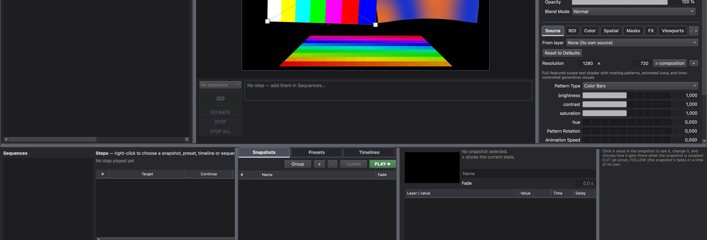

# NYXMAP

### *Real-Time Projection Mapping & Show Composition Instrument*
  
From a single screen to a multi-output installation, design the image and run the show without switching tools.

> **NyxMap is more than a media server.** It is a live composition instrument designed to write, shape, and perform hybrid visual & audio shows.
> 

  
  
  

  

---

## Why NYXMAP

> "This software is an instrument born from over 20 years of hands-on experience and reflection—using countless tools, yet always feeling something was missing. So, here it is!"

---

- **Free, open source, cross-platform.** macOS, Windows and Linux, MIT licensed.

---

## 🎨 1. Compose & Play — Visual Engine

Mix, layer, and manipulate your media score with performance-grade speed.

* **Unified Media Streams:** High-performance video (HAP, live capture, NDI, Syphon/Spout, DeckLink), generative ISF shaders, web streams, and dynamic text.
* **Non-Destructive Routing:** Stack and blend layers, apply color correction, and reuse layer textures (pre- or post-effects) at **zero GPU performance cost**.
* **Precise Spatial Mapping:** Corner pin onto flat surfaces or mesh warp over complex curves and architectural structures.

---

## 🎵 2. Synthesize & Sonify — Built-in Audio Engine

Write sound directly into your performance, or let your visuals write the soundtrack.

| Sound Generation | Processing & Interaction |
| :--- | :--- |
| **Generators:** FM synthesis, granular engines, white/pink noise. | **FX & Envelopes:** Modular Faust instruments, custom audio FX, and ADSR envelopes via `.nyxaudio` presets. |
| **Live Sonification:** Translate pixel motion, camera tracking, and visual color shifts into live audio parameters. | **Cross-Modulation:** Route audio levels to drive visual structures, or drive synthesis engines directly from video playheads. |

---

## ⚡ 3. Express & Animate — 1-Click Modulation

Turn any setting into a dynamic, living parameter in a fraction of a second.

* **Everything talks to everything.** Any parameter can be animated, recalled in a cue or driven by an external controller.
* 🪄 **1-Click Modulation:** Right-click or hover **any** parameter to instantly link an LFO, envelope, video tracker, or audio amplitude follower.
* 🔗 **Internal Linkages:** Seamlessly drive any spatial or visual property using audio, video playheads, or custom mathematical formulas.
* 🎚️ **Smooth Takeovers:** Smart pick-up and jump takeover modes guarantee faders never cause abrupt parameter leaps live.

---

## ⏱️ 4. Write & Sequence — Cues & Timecode

Structure your artistic intent into flexible cues, timelines, and synchronized moments.

## Download

<!-- release-downloads:start -->
Latest published build: **[v0.5.1](https://github.com/PixelStereo/NyxMap/releases/tag/v0.5.1)**.

| macOS — Apple Silicon | Windows — 64-bit | Ubuntu — 64-bit (x86_64) |
| :---: | :---: | :---: |
| **[Download macOS](https://github.com/PixelStereo/NyxMap/releases/download/v0.5.1/NyxMap-macos-v0.5.1.zip)** | **[Download Windows](https://github.com/PixelStereo/NyxMap/releases/download/v0.5.1/NyxMap-windows-v0.5.1.zip)** | **[Download Ubuntu AppImage](https://github.com/PixelStereo/NyxMap/releases/download/v0.5.1/NyxMap-linux-x86_64-v0.5.1.AppImage)** |

Linux: Ubuntu 24.04 or newer. The **[portable archive](https://github.com/PixelStereo/NyxMap/releases/download/v0.5.1/NyxMap-linux-x86_64-v0.5.1.tar.gz)** runs without FUSE or installation. Both Linux packages include Qt, FFmpeg, NDI and OMT; see the [launch instructions](docs/build.md#get-started).
<!-- release-downloads:end -->

Prefer building it yourself? Clone the repository and run `./build.sh` (macOS, Linux, Windows in Git Bash) or `build.cmd` (Windows): it installs what is needed, builds NYXMAP and opens it. See [build and technical details](docs/build.md) and the [known limitations](docs/README.md).

## License

NYXMAP is free software under the [MIT License](LICENSE). Third-party components keep their own licences: see [THIRD-PARTY-NOTICES.md](THIRD-PARTY-NOTICES.md). The NDI runtime included in the packages is covered by the NDI SDK License Agreement; NDI® is a registered trademark of Vizrt NDI AB.
