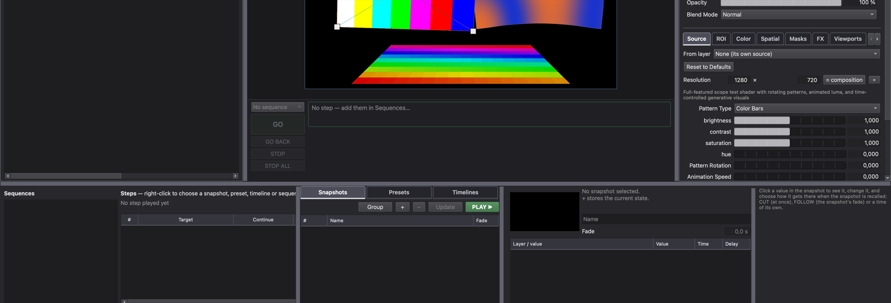

# NYXMAP

### Real-time visuals. Spatial mapping. Live performance.

A creative instrument for projection mapping, video, 3D, generative visuals and audio — built for the stage.

<!-- release-downloads:start -->
<!-- release-downloads:end -->

  

---

## Create. Map. Perform.

NyxMap is a real-time visual instrument for building and performing immersive shows — from a single projector to complex multi-output installations.

- **Visual engine** — video, live inputs, NDI, Syphon / Spout, HAP, ISF shaders, 3D scenes and effects.
- **Projection mapping** — corner pin, mesh warping, shared mapping zones and multi-output workflows.
- **Audio engine** — synthesis, granular sound, modular instruments and audio-reactive visuals.
- **Modulation** — LFOs, envelopes, tracking, audio followers and MIDI / OSC control.
- **Live performance** — presets, snapshots, cues, timelines and timecode.

## Build from source

Clone the repository, then run `./build.sh` or `build.cmd` on Windows.  
[Build instructions](docs/developers/build.md)

## License

[GNU AGPL v3 or later](LICENSE). See [third-party notices](THIRD-PARTY-NOTICES.md) and the [NDI runtime exception](LICENSE-EXCEPTION.md).
