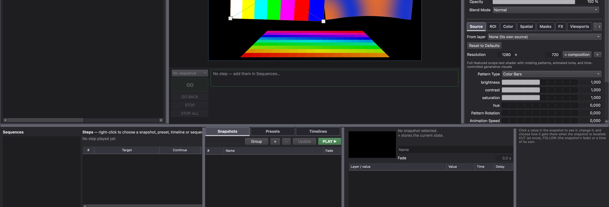

---
hide:
  - navigation
  - toc
---

# NyxMap

**Real-time projection mapping and show composition instrument.** From a single screen to a multi-output installation, design the image, write the sound and run the show without switching tools. Free and open source (GPLv3), for macOS, Windows and Linux.

[Download :material-download:](https://github.com/PixelStereo/NyxMap/releases/latest){ .md-button .md-button--primary }
[Install and launch](getting-started/install.md){ .md-button }

## Explore the documentation

-   :material-rocket-launch: **Getting started**

    ---

    Install NyxMap, then learn the few concepts the rest builds on.

    [Install](getting-started/install.md) · [Concepts](getting-started/concepts.md)

-   :material-projector: **Visuals**

    ---

    Media, generators, 3D scenes and DMX pixel mapping.

    [Media](visuals/media.md) · [Generators](visuals/generators.md) · [3D](visuals/3d-scenes.md) · [Pixel mapping](visuals/pixel-mapping.md)

-   :material-waveform: **Audio**

    ---

    Real-time Faust instruments, video sonification and audio effects.

    [Generators](audio/generators.md) · [Effects](audio/effects.md)

-   :material-tune-variant: **Control and interaction**

    ---

    Animations, interactions, envelopes, clock and camera tracking.

    [Parameters](control/parameters.md) · [Animations](control/animations.md) · [Clock](control/clock-and-envelopes.md) · [Vision](control/vision.md)

-   :material-play-box-multiple: **Show**

    ---

    Snapshots, presets, sequences, operator controls and the web remote.

    [Editing](show/editing.md) · [Controls and remote](show/controls-and-remote.md)

-   :material-connection: **Integrations and reference**

    ---

    Stream Deck, TouchDesigner and the full OSC / OSCQuery API.

    [Companion](integrations/companion.md) · [TouchDesigner](integrations/touchdesigner.md) · [OSC API](reference/osc.md)

## Contributing

NyxMap is developed on [GitHub](https://github.com/PixelStereo/NyxMap). To build it yourself, see [Build from source](developers/build.md). Known problems are listed in [Limitations](project/limitations.md), planned work in the [Roadmap](project/roadmap.md).
