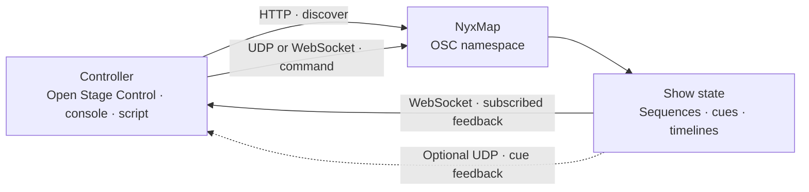

<div align="center">

# NyxMap · OSC API

**Discover the show. Drive it. Follow what actually plays.**

[Connect](#connect) · [Show control](#show-control) · [Live feedback](#live-feedback) · [Parameters](#parameters) · [OSCQuery](#oscquery) · [Open Stage Control](../integrations/open-stage-control/README.md)

</div>

---

## Connect

Enable **OSC / OSCQuery** in NyxMap Settings. Choose the network interface that
the controller can reach.

| Transport | Default | Use |
| :--- | :---: | :--- |
| OSC / UDP | **1234** | Send commands and parameter values. |
| OSCQuery / HTTP | **5678** | Discover addresses, types, ranges and current values. |
| OSCQuery / WebSocket | **5678** | Subscribe to feedback; send binary OSC commands. |
| Optional cue feedback / UDP | **11111** | NyxMap sends cue state to configured `host:port` targets. |



Quick checks, with NyxMap running on this computer:

```sh
curl 'http://127.0.0.1:5678/?HOST_INFO'
curl 'http://127.0.0.1:5678/show/catalog?VALUE'
curl 'http://127.0.0.1:5678/sequence'
```

The [ready-to-load Open Stage Control desk](../integrations/open-stage-control/README.md)
uses one WebSocket for commands and live state. Its pages follow the current
project without manually entering snapshot, preset or timeline numbers.

## Address rules

| Convention | Meaning |
| :--- | :--- |
| `/sequence`, `/snapshot`, `/preset`, `/timeline` | Singular resource families. |
| `<n>` | **1-based** position in a list. `0` in feedback means no selection/cue. |
| `/by-id/<id>/…` | Address a particular object, independently of list order. |
| IDs | Decimal **strings**, including in JSON. Keep them as strings in JavaScript. |
| `f`, `i`, `s`, `T/F` | Float, integer, string, Boolean OSC types. |
| `—` below | Trigger: send a bare OSC message with no arguments. |
| Seconds | Timeline clock values use animation time; cue waits use cue time. |

Stable addresses prevent a list reorder from changing the object a controller
launches. Removed IDs are refused. Always fetch a fresh catalog when connecting
or loading another project. Cue IDs identify runtime cues and must not be saved
as reusable show identifiers.

For the new `/by-id/…` trigger methods, an optional nonzero numeric argument is
accepted; `0` is ignored so a push-button release does not trigger twice. Older
indexed trigger methods execute on each message: configure these as one-shot
buttons rather than sending both press and release.

## Show control

### Sequences

The unqualified commands act on the sequence selected in NyxMap. Several
sequences may run concurrently; selection does not stop the others.

| Address | Arguments | Result |
| :--- | :--- | :--- |
| `/sequence/go` | — | Play the next cue of the selected sequence. |
| `/sequence/back` | — | Play its previous cue. |
| `/sequence/step` | `i cue_number` | GO directly to that cue, with its waits/follows. |
| `/sequence/current` | `i sequence_number` | Select a sequence; does not play a cue. |
| `/sequence/stop` | — | Cancel the selected sequence's pending waits/follows. |
| `/sequence/stop_all` | — | Cancel pending waits/follows for every sequence. |
| `/sequence/<n>/go`, `/back`, `/stop`, `/step` | As above | Control a numbered sequence without selecting it. |
| `/sequence/by-id/<id>/select` | — | Select this particular sequence. |
| `/sequence/by-id/<id>/go`, `/back`, `/stop` | — | Control this particular sequence. |
| `/sequence/by-id/<id>/cue/go` | `s cue_id` | GO to a runtime cue, even after the cue list was reordered. |

**STOP cancels waits.** It does not undo a cue, restore an earlier scene, or stop
media/timelines that the cue has already started. Stop those transports explicitly.
GO BACK is a cue action, not an Undo operation.

Read-only discovery: `/sequence/count`, `/sequence/<n>/name`, `/sequence/<n>/id`,
`/sequence/<n>/active`. `/sequence/<n>/step` also reads its current cue number.

### Snapshots and presets

| Address | Arguments | Result |
| :--- | :--- | :--- |
| `/snapshot/recall` | `i number` | Recall a snapshot by list position. |
| `/snapshot/<n>/recall` | — | Recall this numbered snapshot. |
| `/snapshot/by-id/<id>/recall` | — | Recall a particular snapshot. |
| `/preset/recall` | `i number` | Recall a preset by list position. |
| `/preset/<n>/recall` | — | Recall this numbered preset. |
| `/preset/by-id/<id>/recall` | — | Recall a particular preset. |

Each family exposes `/count`, `/<n>/name` and `/<n>/id`. Recalls use the fades,
delays and captured controls stored in NyxMap. A command does not grant permanent
ownership of its parameters: see [control rules](parameter-control.md).

### Timelines

Use `/timeline/<n>` or `/timeline/by-id/<id>` as the base below.

| Suffix | Arguments | Result |
| :--- | :--- | :--- |
| `/play` | — | Start from stopped, or resume from paused. |
| `/pause` | — | Pause playback. |
| `/stop` | — | Stop and reset the transport clock; parameter values are not restored. |
| `/rewind` | — | Return to the start and apply its values. |
| `/seek` | `f seconds` | Seek on the transport clock; a stopped timeline becomes paused. |
| `/speed` | `f multiplier` | Change playback speed, `0…10`; `0` freezes the clock. |

Read-only discovery: `/timeline/count`, `/timeline/<n>/name`, `/timeline/<n>/id`,
`/timeline/<n>/playing`. The indexed `/seek` and `/speed` nodes are also readable.
Detailed transport feedback is available through `/show/state`.

### Composition

| Address | Value | Meaning |
| :--- | :--- | :--- |
| `/composition/opacity` | `f 0…1` | Composition opacity target. |
| `/composition/volume` | `f 0…2` | Audio master. |
| `/composition/blackout` | Boolean | Blackout for picture and sound. |
| `/composition/blackout/fade` | `f seconds` | Blackout fade duration. |
| `/composition/pause` | Boolean | Hold composition time at zero speed until released. |
| `/composition/speed` | `f 0…10` | Composition time multiplier. |
| `/composition/width`, `/height` | `i pixels` | Composition dimensions. |
| `/composition/fps` | `f fps` | Frame-rate target; `0` follows screen refresh. |

Clock generators and some external/live sources have their own time domains;
composition pause is not a universal freeze of every input.

## Live feedback

### Catalog: `/show/catalog`

Read through OSCQuery. `VALUE[0]` is a JSON string with **`version: 1`** and
arrays: `sequences`, `snapshots`, `presets`, `timelines`, `layers`.

```json
{
  "version": 1,
  "layers": [{"id": "7", "parent": "0", "index": 1, "name": "Background", "group": false, "viewport": false, "path": "/show/layer/by-id/7"}],
  "snapshots": [{"id": "12", "index": 1, "name": "Opening look"}],
  "presets": [],
  "timelines": [{"id": "8", "index": 1, "name": "Fade", "duration": 12}],
  "sequences": [{
    "id": "3", "index": 1, "name": "Main", "loop": false,
    "cues": [{
      "id": "41", "index": 1, "name": "Opening look", "text": "House out",
      "description": "Stand by lighting", "target_type": "snapshot",
      "target_id": "12", "missing": false, "prewait": 0,
      "action_duration": 2, "postwait": 0, "continue": "wait"
    }]
  }]
}
```

Empty lists are `[]`. `target_type` is `snapshot`, `preset`, `timeline`, `sequence`
or `empty`. Missing references remain visible with `missing: true`.
`action_duration` is the estimate at query time; `-1` means no finite end. Runtime
feedback takes precedence over that estimate.

### Playback: `/show/state`

Read once over HTTP or **LISTEN** over WebSocket. `VALUE[0]`, or the first argument
of a binary OSC `/show/state` message, is JSON with:

| Field | Contents |
| :--- | :--- |
| `version` | `1`. |
| `values` | Address → scalar dictionary of the sequence/cue fields below, plus `/sequence/id`, `/composition/pause`, `/composition/blackout`, `/composition/speed`. |
| `timelines` | `id`, `state`, `position`, `duration`, `elapsed`, `remaining`, `progress`, `pass`, `speed`. |
| `sequences` | `id` and `active` for each sequence, including background ones. |

Timeline `state` is `playing`, `paused` or `stopped`. `position` and `progress`
describe the current pass. `elapsed` is its transport clock; `remaining` covers
the finite run, or is `-1` when endless. These are **animation seconds**, not a
promise of wall-clock completion: speed, composition pause and time scaling can
change when it ends. `progress` is `0…1`; pass numbers start at `1`.

Subscribed values are checked every 40 ms and sent when changed. Several clients
share the same value read per address. The payload contains telemetry, not full
timeline curves. Do not fetch and rebuild the whole widget tree on each tick.

### Cue fields

These appear in `/show/state.values` and in the optional UDP cue feedback.

| Address | Meaning |
| :--- | :--- |
| `/sequence/name`, `/index`, `/steps` | Selected sequence name, list number and cue count. |
| `/sequence/running` | Pending pre-wait or follow; STOP has something to cancel. |
| `/sequence/go_enabled`, `/back_enabled` | A next/previous cue is available. |

For each role **`previous`**, **`current`**, **`next`**, the base is
`/sequence/cue/<role>`:

| Suffix | Meaning |
| :--- | :--- |
| `/number`, `/name`, `/label` | Cue number, target name, display-ready `number · name`. |
| `/text`, `/description` | Operator text and advance notice. |
| `/prewait`, `/action`, `/postwait` | Timing in seconds; action `-1` means endless. |
| `/continue` | `wait`, `follow`, `auto-follow`. |
| `/phase` | `pre-wait`, `action`, `post-wait`, `done`, or empty before GO. |
| `/elapsed`, `/elapsed_text` | Time since GO, as seconds and formatted text. |
| `/remaining`, `/remaining_text` | Time to the cue's end; `-1` / `∞` when endless. |
| `/progress`, `/percent` | Overall completion, `0…1` / `0…100`. |
| `/phase_progress`, `/phase_percent` | Completion of the current timing phase. |

`current` means the last cue given GO; it may still be in its pre-wait. `next`
means the cue a new GO will play. Follow can start another cue before the earlier
action finishes. A `done` cue's elapsed counter can keep increasing.

Optional UDP feedback is enabled in Settings with one or more target addresses.
It sends changes at 10 Hz, plus a full refresh every two seconds. Its additional
`/sequence/modified` indicator belongs to the GUI edit state and is not part of
`/show/state`.

## Parameters

The exact tree depends on the loaded sources, generators, FX, groups and live
inputs. Discover it instead of guessing shader names or hard-coding FX slots.

```text
/layer/<name>/opacity
/layer/<name>/position        <x> <y>
/layer/<name>/position/x      <x>
/layer/<name>/position/y      <y>
/layer/<group>/layer/<name>/…
/viewport/<name>/…
/interaction/<name>/…
```

Right-click a parameter in NyxMap and choose **Copy OSC address**. The namespace
publishes each node's type, range, access and description. Source/ISF values are
under `param`; clocks under `clock`; FX expose their own parameter subtrees.

Names are case-sensitive and made OSC-safe: spaces/reserved characters become
underscores, with suffixes for duplicate siblings. Renaming or moving a layer
changes its path. The OSCQuery `DESCRIPTION` retains its display name.

For a remote editor, `/show/catalog.layers` lists every layer, group and viewport
with string `id`/`parent`, 1-based `index`, `name`, Boolean `group`/`viewport` and
`path`. The additive field does not change catalog schema version 1. Each `path`
is `/show/layer/by-id/<id>`: GET it over OSCQuery to discover that object's types,
ranges, access and values. Its read-only `/id` verifies the selected identity.
Use this stable prefix for commands and LISTEN subscriptions, for example:

```text
/show/layer/by-id/<id>/opacity       <float>
/show/layer/by-id/<id>/position      <x> <y>
/show/layer/by-id/<id>/param/<name>   <value…>
/show/layer/by-id/<id>/fx/<fx>/param/<name>  <value…>
```

These controls have the same behavior and lock rules as the name-based paths.
Layer IDs survive renaming/moving; deleted IDs are refused. Each group exposes
its own controls; select its children through their catalog IDs. Source and FX
parameter paths can change after structural edits: invalidate the editor on
PATH_CHANGED and rediscover it. Subscribe only to visible readable controls,
and IGNORE them when leaving the section. Feedback must never echo as a write.

**Tuples and components:** grouped XY and RGB(A) addresses accept multiple OSC
arguments. Component addresses remain usable independently. XY uses raw numeric
units. RGB(A) normally uses `0…1`; a tuple containing a channel above `1` is
interpreted as `0…255`. Alpha can be omitted from a color tuple.

**Patterns:** UDP and binary WebSocket writes accept `*`, `?`, `[…]`, `{a,b}`.
For example, `/layer/*/opacity 0.5` targets matching direct children. A wildcard
does not cross a `/` separator. NaN and infinity are refused. Locked layers
refuse most parameter writes; transport and designated lock/enable controls are
exceptions.

An address claimed by an enabled OSC interaction feeds its mapping chain instead
of also writing the native value. Audio, MIDI, OSC and automation can still
compete on a target; see [parameter-control rules](parameter-control.md).

### Reset a parameter

Writable layer/source/FX parameters with a declared default publish two
NyxMap-specific OSCQuery attributes:

| Attribute | Meaning |
| :--- | :--- |
| `NYXMAP_DEFAULT` | Typed default argument array, independent of `VALUE`. |
| `NYXMAP_RESET` | Trigger address that resolves the native default when called. |

For example, a layer's opacity advertises `[1]` and
`/show/layer/by-id/<id>/opacity/reset`. Send a bare OSC message to that address.
`…/position/reset` or `…/param/startColor/reset` restores a whole XY/RGB(A) value;
`…/position/x/reset` or `…/param/startColor/r/reset` restores one component.
Named layer paths expose the same actions. A numeric/Boolean trigger release of
zero is refused. Triggers, read-only controls and values without a declared
default do not advertise resets.

Defaults come from NyxMap's parameter registry, including ISF inputs. Reset
actions resolve the current source, FX and composition dimensions under the
engine lock. They obey layer locking and ordinary parameter limits; removed
parameters/layers cannot reset another target. HTTP attribute queries support
`?NYXMAP_DEFAULT` and `?NYXMAP_RESET`; `HOST_INFO.EXTENSIONS` advertises them.
The remote uses these actions instead of writing cached default numbers.

## OSCQuery

### HTTP discovery

| Request | Reply |
| :--- | :--- |
| `GET /` | Complete namespace tree. |
| `GET /path` | Node, current values and children. |
| `GET /path?VALUE` | Its values. |
| `GET /path?TYPE`, `?RANGE`, `?ACCESS` | One node attribute. |
| `GET /?HOST_INFO` | Host name, OSC transport/port, WebSocket support. |

Nodes use `FULL_PATH`, `CONTENTS`, `TYPE`, `VALUE`, `RANGE`, `ACCESS`,
`DESCRIPTION`, `CLIPMODE` where applicable. `ACCESS` is `0` container, `1` read,
`2` write, `3` read/write. HTTP is discovery/readback: send writes as OSC.

### WebSocket subscriptions

Connect to `ws://<nyxmap-host>:5678/`. Send text frames:

```json
{"COMMAND":"LISTEN","DATA":"/show/state"}
```

```json
{"COMMAND":"IGNORE","DATA":"/show/state"}
```

Value updates are **binary OSC packets**, not JSON text frames. `/show/state`
itself carries a JSON string inside that OSC packet. Commands can also be sent as
binary OSC packets over the same socket.

Structural edits produce this text notification:

```json
{"COMMAND":"PATH_CHANGED","DATA":"/"}
```

Fetch the catalog/tree again. LISTEN and IGNORE target an exact address, not a
wildcard subscription. Reconnect clients must subscribe again and refresh their
catalog. Check connection health before sending show commands; do not replay a
buffer of commands that accumulated offline.

## Troubleshooting

| Symptom | Check |
| :--- | :--- |
| No connection | OSC/OSCQuery enabled; chosen interface, host and TCP port reachable. |
| UDP works, lists are empty | TCP `5678` is separate from OSC UDP `1234`. |
| Commands work, no UDP counters | Feedback enabled; target points to the controller's UDP input. The bundled desk uses WebSocket instead. |
| Button fires twice | Use a bare one-shot trigger; do not send a release to legacy trigger methods. |
| A recall appears to be ignored | Layer lock, active drivers, stored fades/delays, or a removed ID. |
| Clock says `∞` | Endless loop, frozen transport or another action with no finite completion. |

NyxMap publishes `_oscjson._tcp` and `_osc._udp` services when announcement is
enabled. OSC/OSCQuery has no authentication or encryption; keep show control on
the intended show network. No request in this guide changes project structure.

Implementation: [namespace](../src/engine/Osc.cpp), [show control](../src/engine/OscShowControl.cpp),
[cue feedback](../src/engine/SequenceFeedback.cpp), [OSC codec](../src/engine/OscCodec.cpp).
