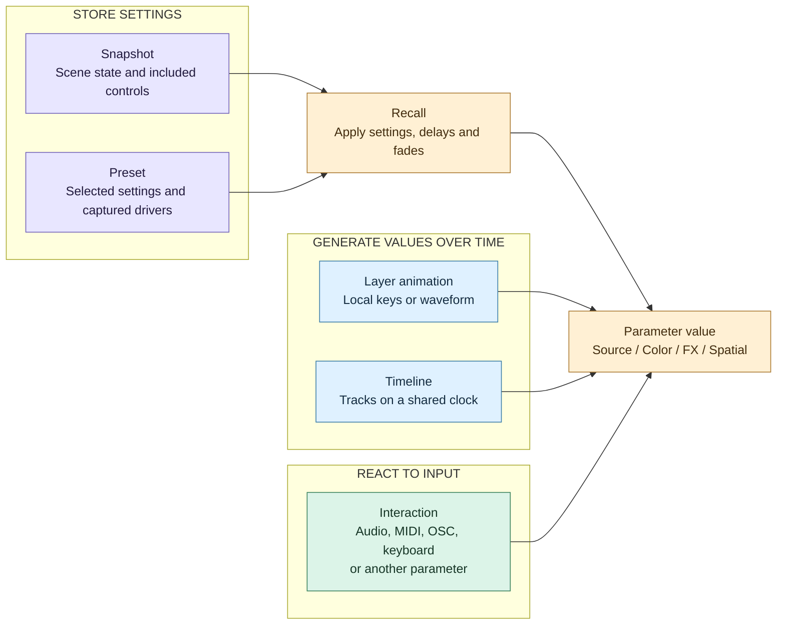

# Parameter control

Snapshots and presets store settings. Layer animations and timelines generate values over time. Interactions translate live input into parameter values. When they target the same parameter, their values are written in order; they are not automatically mixed.

## How the controls connect

Arrows show possible writers, not addition or a permanent ownership hierarchy.

| Control | What it does |
|---|---|
| Snapshot | Recalls scene state, including sources, FX, values, local animation states and interaction settings, subject to inclusion choices. |
| Preset | Recalls selected values and any stored categories, geometry or local drivers; it does not replace the whole scene. |
| Layer animation | Drives a layer parameter or RGB color with keys or a waveform. |
| Timeline | Drives one or more targets using a shared transport. |
| Interaction | Maps input through ranges, optional filtering, a curve and master level, then applies its takeover mode. |

## Current rules

The following order describes competing writes to an existing, unlocked **layer parameter** during a normal render frame. Commands can also write immediately between frames; this is not a transaction covering every control.

1. **Recalls and fades:** there is no fixed snapshot-versus-preset priority. A new recall replaces older active fades on the same addresses, starting from their current values; unrelated fades continue. Parameter delays defer the write until their deadline. Source or topology changes can affect a wider part of the layer.
2. **Layer animations:** playing local animations write next.
3. **Timelines:** playing timelines write after local animations. If multiple timelines write the same address, the later writer in the engine's timeline list wins that frame.
4. **Interactions:** eligible interactions write last. With several competing interactions, list order determines the last successful write, subject to filtering and takeover.

For layer values, a successful animation or interaction write removes that address from active recall fades. It **does not stop a competing timeline or cancel a pending delayed recall**. Manual parameter edits also release active fades without stopping automation. Composition masters and interaction-setting fades use separate paths; the layer fade-cancellation rule is not a universal ownership contract.

### Interaction takeover

| Mode | Behavior |
|---|---|
| Jump (default) | Applies the incoming mapped value directly. |
| Pick-up | Waits until the controller approaches or crosses the current target value. If another writer moves the target away from the last written value beyond tolerance, pick-up releases and must catch it again. |

MIDI, OSC and keyboard interactions normally write on fresh input or while their processed output changes. They do not permanently hold a value after one message. Audio is sampled every frame and can therefore keep overwriting automation. Internal interactions react to source changes. A grouped color interaction normally writes RGB; alpha requires explicit mapping. RGB pick-up waits for all mapped channels to meet their target.

### What a recall can change besides the value

- A snapshot restores included interaction settings and disables interactions absent from its stored list. An interaction present but excluded from recall stays unchanged.
- A snapshot restores local animation states. An animation playing both before and after recall continues its clock; an absent local animation stops. Global timelines are not automatically stopped by that recall.
- A preset can restore captured local animations and interaction definitions. These can immediately compete with its static target values.
- **Start from current value** captures the starting value when playback starts from stopped or is rewound. It does not continuously sample competing controls or grant priority.

### Collision example

Assume all four controls still target the same opacity, the recalls have no delay, and the interaction remains enabled in Jump mode:

| Writer | Value |
|---|---:|
| Preset target | 0.2 |
| Snapshot target | 0.8 |
| Playing timeline | 0.5 |
| Fresh MIDI input | 0.9 |

The interaction produces **0.9 for that frame** and releases the active opacity fade. Without another MIDI message or filter change, the timeline writes again on the next frame and can return opacity to **0.5**. A still-pending delayed recall can execute later. Winning one write does not mean owning the parameter.

## Countdown, stopwatch and clock generators

The Media Bin lists **Countdown**, **Stopwatch** and **Clock** under Generators, with Text and Timecode. Dropped onto a layer, each one is a text layer (same font, size, color, alignment, outline and shadow controls as Text) that shows a time. Their settings and transport are layer parameters under `clock/`: OSC addresses (`/layer/<name>/clock/...`), interactions, snapshots and presets reach them like any other value.

| Address | Generators | Meaning |
|---|---|---|
| `clock/target` | Countdown | `duration` or `time_of_day` (counts down to the next occurrence of `clock/target_time`, across midnight if needed). |
| `clock/duration` | Countdown | Seconds it counts down from. |
| `clock/target_time` | Countdown | Time of day, as text (`20:30:00`, `8:30 PM`). |
| `clock/offset` | Stopwatch | Seconds it counts up from. |
| `clock/format`, `clock/custom_format` | All | Countdown and stopwatch: `hh:mm:ss`, `mm:ss`, `ss`, with tenths (`.t`) or frames (`:ff`), or `custom` with tokens `h hh m mm s ss t tt ttt ff` and `'quoted text'`. Clock: `24h`, `12h`, or `custom` with a Qt date-time format. |
| `clock/fps` | Countdown, Stopwatch | Frames per second for the `ff` token. |
| `clock/at_zero`, `clock/zero_text`, `clock/overtime_color/r,g,b,a` | Countdown | At zero: `stop` (holds 00:00), `text` (shows the text), or `overtime` (counts on below zero in the overtime color). |
| `clock/seconds`, `clock/date`, `clock/zone` | Clock | Seconds and date shown; time zone (empty: system, `UTC`, `+02:00`, `Europe/Paris`). `clock/zone` also applies to a countdown to a time of day. |
| `clock/play` | Countdown, Stopwatch | Running or paused (stored in snapshots and presets). |
| `clock/elapsed` | Countdown, Stopwatch | Seconds run since the start (stored; a recall leaves a clock that is already running untouched). |
| `clock/start`, `clock/pause`, `clock/reset` | Countdown, Stopwatch | Actions. Reset returns to the start and pauses; starting a countdown that finished starts it again from its full duration. |
| `clock/restart` | Countdown, Stopwatch | "Restart on recall": a snapshot or preset holding it on starts the clock from the beginning. |
| `clock/value`, `clock/zero` | Read only | The time shown in seconds; whether a countdown reached zero. An internal interaction can follow `clock/zero` to drive another parameter at zero. |

Countdowns and stopwatches follow real time (not the composition speed). Only their own transport and **STOP ALL** pause them. A project saves the elapsed time and running state; on load, a running clock continues from the saved value.

## Proposed improvements — not implemented

| Priority | Proposal | Acceptance criteria |
|---|---|---|
| P1 | Show the active writer beside each parameter, with competing drivers and pending recalls in its details. | Users can identify why a value changed without inspecting several panels. |
| P1 | Add explicit per-parameter takeover and return policies: temporary override, hold until release, or blend back to automation. | A MIDI gesture has a predictable lifetime; releasing it resumes the underlying timeline at its current position without stopping unrelated tracks. |
| P1 | Define whether takeover cancels, suspends or preserves delayed recalls. Expose that choice. | A queued recall cannot unexpectedly reclaim a held parameter. |
| P2 | Apply a consistent arbitration model to layer values, composition masters and interaction settings. | Simultaneous recall, timeline and input scenarios follow a documented rule across all targets. |
| P2 | Offer explicit Replace, Add and Multiply modes with a defined base value, evaluation order and clamping. | Users can combine automation and live modulation deliberately, including grouped RGB, without depending on list order. |

Keep existing project behavior until users opt into a new policy. Validate simultaneous writes, sparse MIDI versus continuous audio, pick-up, RGB, delayed recalls and release behavior in GitHub CI.

Implementation references: [frame order](../src/engine/Render.cpp), [animation evaluation](../src/engine/Animations.cpp), [recalls and fades](../src/engine/Snapshots.cpp), [interaction evaluation](../src/engine/InteractionsEngine.cpp), [takeover](../src/engine/Interactions.cpp).
