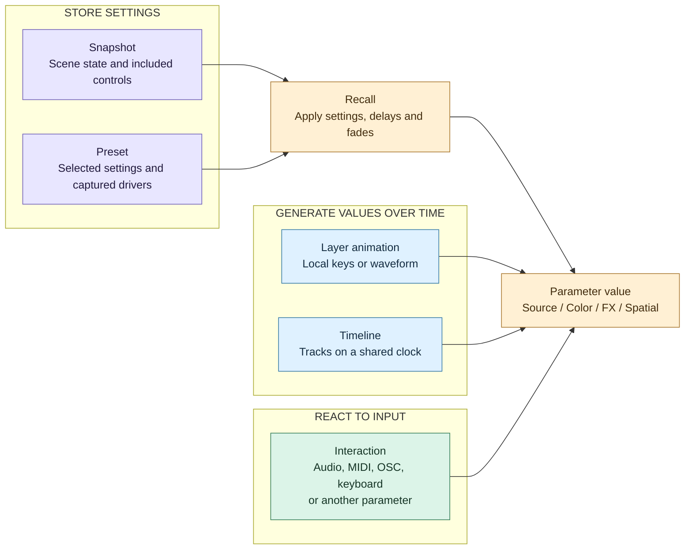

# Parameter control

Snapshots and presets store settings. Layer animations and timelines generate values over time. Interactions translate live input into parameter values. When they target the same parameter, their values are written in order; they are not automatically mixed.

## How the controls connect

Arrows show possible writers, not addition or a permanent ownership hierarchy.

## Grouped XY parameters

ISF `point2D` inputs and native layer position, pivot, scale and corner offsets
offer an **XY** target alongside their separate **X** and **Y** components.
Presets can capture the pair or either component.

An XY interaction has two input chains: choose **X input and mapping** or
**Y input and mapping** to configure its source, ranges, filters and
takeover independently. For a single OSC XY message, use the same address with
arguments `0` and `1`; separate addresses or protocols also work. A fresh X-only
event does not resend a stale Y value.

An XY animation is one track with a shared transport and two independent
curves or waves. Select X or Y to edit its keys, period, phase, center and
amplitude. **Drive axis** leaves either component available to another control.
Adding a separate X animation preserves the grouped Y animation, and vice versa.
Wave phase is measured in cycles: equal sine periods with X phase `0` and Y phase
`0.25` produce an ellipse. Each curve supports **Start from the current value**.

Open **XY path** in a local animation or timeline track to see the sampled
trajectory for the current pass. Blue marks the start, gold the end and green
the playhead. Click or drag along the path to seek the shared transport;
edit keys and wave settings through the X/Y selector. The preview follows
continuous wave time across loops and ping-pong, captured current-value starts,
and the live value of a disabled axis. Axis ranges are fitted independently:
this is a parameter plot, not a spatial preview of the composition.

Design references: [Chataigne Mapping 2D](https://benkuper.notion.site/Mapping-2D-Layer-ce3f908cae484a99acdd8b486c5de1fb)
and [ossia component addressing](https://ossia.io/score-docs/in-depth/unit-system.html).

| Control | What it does |
|---|---|
| Snapshot | Recalls scene state, including sources, FX, values, local animation states and interaction settings, subject to inclusion choices. |
| Preset | Recalls selected values and any stored categories, geometry or local drivers; it does not replace the whole scene. |
| Layer animation | Drives a layer parameter or RGB color with keys or a waveform. |
| Timeline | Drives one or more targets using a shared transport. An event track fires an action (Source › Rewind, Show › GO, a snapshot's recall, a shader's event…) or sets a value (a switch such as Source › Play or Layer › Visible, a choice such as Blend Mode, a number a curve does not drive such as Source › Seek To) at each of its flags as the playhead reaches them; seeking does not fire them. |
| Interaction | Passes its source's value through an ordered list of filters (Remap, smoothing, Curve, Math…) and its master level to its target, then applies its takeover mode. |

## Current rules

The following order describes competing writes to an existing, unlocked **layer parameter** during a normal render frame. Commands can also write immediately between frames; this is not a transaction covering every control.

1. **Recalls and fades:** there is no fixed snapshot-versus-preset priority. A new recall replaces older active fades on the same addresses, starting from their current values; unrelated fades continue. Parameter delays defer the write until their deadline. Source or topology changes can affect a wider part of the layer.
2. **Layer animations:** playing local animations write next.
3. **Timelines:** playing timelines write after local animations. If multiple timelines write the same address, the later writer in the engine's timeline list wins that frame.
4. **Interactions:** eligible interactions write last. With several competing interactions, list order determines the last successful write, subject to filtering and takeover.

For layer values, a successful animation or interaction write removes that address from active recall fades. It **does not stop a competing timeline or cancel a pending delayed recall**. Manual parameter edits also release active fades without stopping automation. Composition masters and interaction-setting fades use separate paths; the layer fade-cancellation rule is not a universal ownership contract.

### Interaction takeover

| Mode | Behavior |
|---|---|
| Jump (default) | Applies the incoming mapped value directly. |
| Pick-up | Waits until the controller approaches or crosses the current target value. If another writer moves the target away from the last written value beyond tolerance, pick-up releases and must catch it again. |

MIDI, OSC and keyboard interactions normally write on fresh input or while their processed output changes. They do not permanently hold a value after one message. Audio is sampled every frame and can therefore keep overwriting automation. Internal interactions react to source changes. A grouped color interaction normally writes RGB; alpha requires explicit mapping. RGB pick-up waits for all mapped channels to meet their target.

A video or audio layer exposes where it plays as two read-only values an Internal interaction can follow: `playhead` (**Source › Playhead (s)**, seconds into the media) and `progress` (**Source › Progress**, 0 at the in point, 1 at the out point). For example, map a video's Progress to another layer's Position X to move it along with the playhead. Neither is saved or animated.

### Show actions and layer switches

The show's own actions are values of the composition, so a key, a MIDI note, an OSC message, another value (Internal) or a timeline flag reaches them like any other target. Each one is addressed by the stable id of what it acts on, and the list follows the snapshots, presets, timelines and sequences as they are added, renamed or removed.

| Address | Kind | Meaning |
|---|---|---|
| `show/go`, `show/back`, `show/stop`, `show/stop_all` | Action | The selected sequence's GO, GO Back, Stop; Stop All stops every sequence. |
| `sequence/<id>/go`, `/back`, `/stop` | Action | One sequence, whatever is selected. |
| `snapshot/<id>/recall`, `preset/<id>/recall` | Action | Recalls it, with its fade. |
| `timeline/<id>/play`, `/pause`, `/stop`, `/rewind` | Action | A timeline's transport. |
| `timeline/<id>/playing` | Read only | Whether it plays (an Internal interaction can follow it). |
| `show/blackout`, `show/pause` | Switch | The blackout (with its default fade) and the pause. |

Every layer also has **Layer › Visible** (`enable`) and **Layer › Solo** (`solo`), the switches of the layer list, and a video or audio layer has **Source › Seek To (s)** (`seek`, written only). None of these is saved in snapshots or presets: a snapshot shows and hides its layers itself, with its fades. An action runs right after it is written, on the engine's thread, exactly as the button that does the same.

An Internal interaction can follow a switch (0 / 1) and a choice (its index: 0 for the first one).

### Interaction filters

A Mapping's **Filters** are a list in a frame, applied from the top, like a layer's effects: **+** adds one (of the kind chosen), a click on a filter selects it, **−** removes the selected one and **▲ ▼** move it; each has its own on / off, and a meter with the number of what comes out of it now. Their settings are number fields with no bounds (press and slide sideways, or click to type any value).

There is no range of its own: the value enters the first filter as the source gives it (a key 1 / 0, MIDI 0..1, OSC as sent, Internal in the value's own units, a choice as its index) and the target receives what comes out of the last one, scaled by the master level, in its own units — a number that value, a switch on from 0.5, a choice the one of that index, an action fired each time it goes up past 0.5. With no filter, the value goes through as it is. To fit one range into another, add a **Remap** (from **+** it starts from the source's usual range to the target's).

| Filter | Settings | What it does |
|---|---|---|
| **Remap** | In Min, In Max, Out Min, Out Max | From one range to another (either way round: Out Max below Out Min inverts), held within Out at its ends. |
| **Curve** | its keys | Shapes the value with a drawn curve (easing, Bézier, hold), 0..1 in, 0..1 out. |
| **Math** | operation, value *a* | `x + a`, `x − a`, `x × a`, `x ÷ a` (÷ 0 leaves it), modulo, power, min, max, absolute, floor / ceil / round to a step of *a*, **1 − x** (invert). |
| **Clamp** | Min, Max | Keeps the value between two values. |
| **Steps** | Steps | A few levels only, 0 and 1 included (3 steps: 0, 0.5, 1). |
| **Threshold** | Threshold, Margin | 1 above the threshold, 0 below it; the margin around it keeps it from flickering. |
| **Toggle** | Threshold | Each time the value goes up past the threshold, the other state (0, 1, 0…): a key or a pad, on then off. |
| **Average** | Window | The average of the last moments. |
| **Weighted Average** | Smoothing | Smoothed, about 95 % of the way in its time. |
| **Attack Release** | Attack, Release | Rises and falls at speeds of their own. |
| **Damper** | Response, Damping | A spring that follows, overshooting more or less. |
| **Pulse Detection** | Threshold, Decay | A pulse on each sudden rise, decaying. |
| **Delay** | Delay | The value of a moment ago. |
| **Speed** | Full scale, Smoothing | How fast the value moves, either way (1: the full scale per second). |

**Math › 1 − x**, a falling Curve or a Remap with its Out the other way round inverts.

Each filter's on / off and settings are values of the interaction — `interaction/<id>/filters/<n>/enable`, `/a`, `/b`, `/c`, `/d` (`<n>` from 1, in the order of the list; a Remap: In Min, In Max, Out Min, Out Max) — so presets, snapshots, OSC and timelines reach them; `interaction/<id>/filters` is the whole list (its kinds, order, operations and curves), set at once.

### Interaction modes: Mapping and Action

An interaction has a **Mode**. **Mapping** (the default) drives one target continuously through its filters and its master level. **Action** does not map; it tests the source's value and acts when the answer changes, as Chataigne's actions do:

- **Conditions** compare the value the source gives, in its own units (a key 1 / 0, MIDI 0..1, OSC as sent, Internal in the value's units: seconds for Playhead, 0 / 1 for a switch, the index for a choice), with `=`, `≠`, `>`, `≥`, `<`, `≤`, **in range** or **out of range** (both ends included, in either order). **True when** all of them hold (and) or any of them (or). With no condition, each value the source gives does the **If true** actions (a key: each press and each release).
- When the answer **becomes true**, the actions **If true** are done, in order; when it **becomes false**, the actions **If false**. Nothing is done while it stays the same, and the very first answer only acts if it is true. Edited conditions are tried again at once on an Internal source's current value. A key pressed and released in one frame gives both, in order.
- Each action sets a value of the show: fires an action (GO, a snapshot's recall, Source › Rewind…), sets a switch On or Off, a choice, or a number. A locked layer is left alone, and a fade running on the value lets go, as for a Mapping.
- The list shows **true** / **false** in its Value column; the settings show the input and whether the conditions hold now. A snapshot keeps an Action's on / off state, not its conditions or actions. Switching back to Mapping keeps the Action's settings for later.

### What a recall can change besides the value

- A snapshot restores included interaction settings and disables interactions absent from its stored list. An interaction present but excluded from recall stays unchanged.
- A snapshot restores local animation states. An animation playing both before and after recall continues its clock; an absent local animation stops. Global timelines are not automatically stopped by that recall.
- A preset can restore captured local animations and interaction definitions. These can immediately compete with its static target values.
- **Start from current value** captures the starting value when playback starts from stopped or is rewound. It does not continuously sample competing controls or grant priority.

### Collision example

Assume all four controls still target the same opacity, the recalls have no delay, and the interaction remains enabled in Jump mode:

| Writer | Value |
|---|---:|
| Preset target | 0.2 |
| Snapshot target | 0.8 |
| Playing timeline | 0.5 |
| Fresh MIDI input | 0.9 |

The interaction produces **0.9 for that frame** and releases the active opacity fade. Without another MIDI message or filter change, the timeline writes again on the next frame and can return opacity to **0.5**. A still-pending delayed recall can execute later. Winning one write does not mean owning the parameter.

## Countdown, chronometer and clock generators

The Media Bin lists **Countdown**, **Chronometer** and **Clock** under Generators, with Text and Timecode. Dropped onto a layer, each one is a text layer (same font, size, color, alignment, outline and shadow controls as Text) that shows a time. Their settings and transport are layer parameters under `clock/`: OSC addresses (`/layer/<name>/clock/...`), interactions, snapshots and presets reach them like any other value.

| Address | Generators | Meaning |
|---|---|---|
| `clock/target` | Countdown | `duration` or `time_of_day` (counts down to the next occurrence of `clock/target_time`, across midnight if needed). |
| `clock/duration` | Countdown | Seconds it counts down from. |
| `clock/target_time` | Countdown | Time of day, as text (`20:30:00`, `8:30 PM`). |
| `clock/offset` | Chronometer | Seconds it counts up from. |
| `clock/format`, `clock/custom_format` | All | Countdown and chronometer: `hh:mm:ss`, `mm:ss`, `ss`, with tenths (`.t`) or frames (`:ff`), or `custom` with tokens `h hh m mm s ss t tt ttt ff` and `'quoted text'`. Clock: `24h`, `12h`, or `custom` with a Qt date-time format. |
| `clock/fps` | Countdown, Chronometer | Frames per second for the `ff` token. |
| `clock/at_zero`, `clock/zero_text`, `clock/overtime_color/r,g,b,a` | Countdown | At zero: `stop` (holds 00:00), `text` (shows the text), or `overtime` (counts on below zero in the overtime color). |
| `clock/seconds`, `clock/date`, `clock/zone` | Clock | Seconds and date shown; time zone (empty: system, `UTC`, `+02:00`, `Europe/Paris`). `clock/zone` also applies to a countdown to a time of day. |
| `clock/play` | Countdown, Chronometer | Running or paused (stored in snapshots and presets). |
| `clock/elapsed` | Countdown, Chronometer | Seconds run since the start (stored; a recall leaves a clock that is already running untouched). |
| `clock/start`, `clock/pause`, `clock/reset` | Countdown, Chronometer | Actions. Reset returns to the start and pauses; starting a countdown that finished starts it again from its full duration. |
| `clock/restart` | Countdown, Chronometer | "Restart on recall": a snapshot or preset holding it on starts the clock from the beginning. |
| `clock/value`, `clock/zero` | Read only | The time shown in seconds; whether a countdown reached zero. An internal interaction can follow `clock/zero` to drive another parameter at zero. |

Countdowns and chronometers follow real time (not the composition speed). Only their own transport and **STOP ALL** pause them. A project saves the elapsed time and running state; on load, a running clock continues from the saved value.

## Line generator

The Media Bin also lists **Line** under Generators. It works like MadMapper's Line tool: you draw segments on a layer, then animate them along their length. Its shader is built into the application, so a project never loses it. The layer's source is saved as `/NyxMap/Generators/Line` with its lines, and there is no file to find, relink or collect.

**Drawing.** Dropping Line onto a layer starts drawing a line in the preview. **Draw Line** in its Source tab draws another; a layer holds as many lines as needed.
- Click each point. Enter, a double-click, or the first point again ends the line (the first point again closes it).
- Backspace takes the last point back. Esc cancels.
- Afterwards: drag a point to move it, drag a segment to move the whole line, double-click a segment to add a point. Delete removes the selected point (or the line, below two points) or the selected line.
- Every edit is undoable. **Delete All** removes them all.

The points are in the layer's own frame, so moving, scaling or warping the layer moves its lines with it.

**Animation.** These are the shader's inputs, layer parameters under `param/` (`/layer/<name>/param/rate`…), so they can be animated and reached from OSC, interactions, snapshots and presets. The Source tab's `speed` scales its time; Resolution sets its picture size, as for any ISF generator.

| Address | Meaning |
|---|---|
| `param/animation` | `0` Solid, `1` Fill, `2` Chase, `3` Strobe, `4` Pulse, `5` Media. |
| `param/lineColor/r,g,b,a` | The lines' color. With `param/gradient` on, it goes to `param/endColor` from each line's start to its end. |
| `param/backColor/r,g,b,a` | Off the lines and where they are not lit (transparent by default). |
| `param/thickness` | Pixels of the generator's picture. Joins and ends are round. `param/softness` feathers the edges. |
| `param/rate` | Cycles per second, either way: the fill's loop, the dashes' scrolling, the strobe's and the pulse's frequency, the media's scrolling. |
| `param/fill` | Fill with `rate` 0: the part lit from the start (animate it to grow the line). With a rate, the fill loops. |
| `param/dashes`, `param/dashWidth` | Chase: dashes along each line, each one a fraction of its period. |
| `param/duty` | Strobe: the part of each cycle lit. |
| `param/along` | `0` each line from its start to its end, `1` each segment on its own. |
| `param/reverse` | From the end to the start. |
| `param/cascade`, `param/cascadeBy` | Offset: each line (`0`) or each segment of a line (`1`) starts this fraction of a cycle after the one before it. |
| `param/media` | Media: an image or another layer's picture laid along the lines, its width along the path, its height across the thickness. |

**Pixel mapping.** **Fixtures on Lines** in the Source tab puts a fixture of the chosen one-pixel type (RGB, RGBW…) on each line. Each one has that many pixels spread evenly along its line, in DMX order from the line's first point, at the next free addresses. It follows its line when the line is edited or the layer moves. In the views it shows as a strip: its path and its pixels. It cannot be moved, resized or turned on its own. A fixture keeps its last place if its layer or line is removed. A layer inside a group is followed through its own mapping only, not its group's.

## Proposed improvements — not implemented

| Priority | Proposal | Acceptance criteria |
|---|---|---|
| P1 | Show the active writer beside each parameter, with competing drivers and pending recalls in its details. | Users can identify why a value changed without inspecting several panels. |
| P1 | Add explicit per-parameter takeover and return policies: temporary override, hold until release, or blend back to automation. | A MIDI gesture has a predictable lifetime; releasing it resumes the underlying timeline at its current position without stopping unrelated tracks. |
| P1 | Define whether takeover cancels, suspends or preserves delayed recalls. Expose that choice. | A queued recall cannot unexpectedly reclaim a held parameter. |
| P2 | Apply a consistent arbitration model to layer values, composition masters and interaction settings. | Simultaneous recall, timeline and input scenarios follow a documented rule across all targets. |
| P2 | Offer explicit Replace, Add and Multiply modes with a defined base value, evaluation order and clamping. | Users can combine automation and live modulation deliberately, including grouped RGB, without depending on list order. |

Keep existing project behavior until users opt into a new policy. Validate simultaneous writes, sparse MIDI versus continuous audio, pick-up, RGB, delayed recalls and release behavior in GitHub CI.

Implementation references: [frame order](../src/engine/Render.cpp), [animation evaluation](../src/engine/Animations.cpp), [recalls and fades](../src/engine/Snapshots.cpp), [interaction evaluation](../src/engine/InteractionsEngine.cpp), [takeover](../src/engine/Interactions.cpp).
