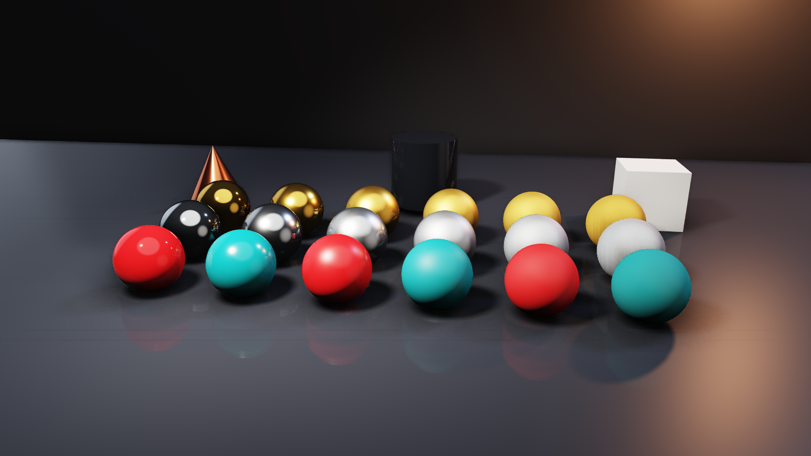

# PBR

A test chart for the 3D renderer, made only of built-in primitives: no media, so the project opens anywhere.

- **Spheres:** gold, steel and red or teal plastic. Roughness rises from left to right (0.06 to 0.91).
- **Lights:** a warm **spot** with a wide falloff, a cool **directional** fill, and an orange **point** light from behind on the right. All three cast shadows.
- **Light:** the scene has no environment layer, so the metals reflect its **Studio Light**.
- **Contact:** contact shadows where the spheres meet the floor, and the floor reflecting them.

Open `PBR.nyxmap`, then choose "PBR Scene (3D view)" in a preview's source menu to see the lights and the spot's cone.

```bash
NyxMap --render preview.png --frames 3 --strict PBR.nyxmap
```


